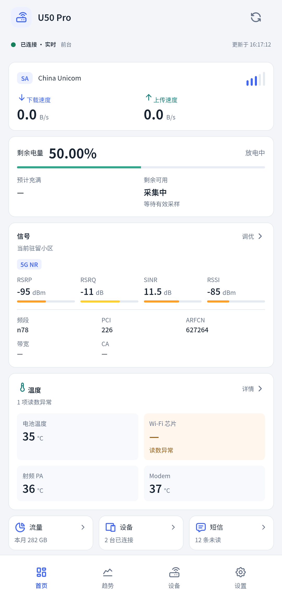
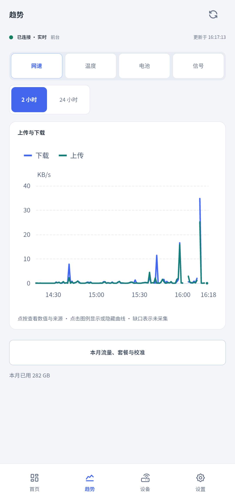
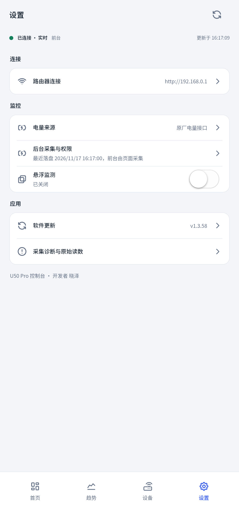

# U50PRO-CON · U50 Pro 控制台

面向中兴 U50 Pro / MU5120 的 Android 管理应用。在手机上查看实时网速、电量、信号和温度，管理网络、短信与连接设备，并保存本机最近 24 小时的监测历史。

- 当前版本：`1.3.58`
- Android versionCode：`78`
- Android 包名：`cn.mu5120.console`
- 支持系统：Android 6.0 及以上
- 开发者：晓泽

[下载 Android APK](https://github.com/xiaoze171/U50PRO-CON/releases/tag/v1.3.58) · [1.3.58 更新说明](docs/releases/v1.3.58.md)

## 安装与连接

1. 在 GitHub Release 下载 `U50PRO-Console-v1.3.58.apk`，按系统提示完成安装。
2. 将手机连接到路由器所在的局域网。
3. 在「设置 → 路由器连接」中填写管理地址和密码。默认地址为 `http://192.168.0.1`，初始密码为 `111111`；已修改密码时填写实际密码。
4. 应用启动后会运行后台采集。需要息屏持续采集时，按「后台采集与权限」中的说明授权；需要悬浮监测时开启对应开关。

应用沿用包名和签名，符合升级条件时可覆盖安装并保留本机配置及历史。卸载应用或清除应用数据会删除这些内容。

## 界面预览

以下为 1.3.58 常规 Android 版实机截图，裁去系统状态栏，未替换界面数据。

**首页：实时速率、电池、信号与温度**



**趋势：最近 2 小时或 24 小时的监测记录**



**设置：路由器连接、后台采集、悬浮监测与软件更新**



## 四个页面入口

| 页面 | 主要功能 |
| --- | --- |
| 首页 | 下载与上传速率、电池电量及时间估算、蜂窝信号、温度，以及流量、设备和短信入口 |
| 趋势 | 网速、温度、电量和信号曲线；最近 2 小时或 24 小时切换；电池历史记录 |
| 设备 | 连接设备、网络调优、短信、原厂后台、设备详情与控制 |
| 设置 | 路由器连接、电量来源、后台采集与权限、悬浮监测、软件更新、采集诊断 |

首页点击信号区域可直接进入网络调优。图表支持点按查看数值和采集来源，温度图例可显示或隐藏曲线；读取失败、数据缺口与实际零值分别显示。

## 原厂电池与续航

常规版读取路由器原厂返回的电量、充电状态和电池温度。电量使用 `battery_vol_percent` / `battery_value`，充电状态依据原厂充电及外部供电标记。

“预计充满”和“剩余可用”独立显示，采用同一套前后台估算规则：

- 保留最近 24 小时电量历史，取当前连续充电或放电状态的记录。
- 至少有两个有效记录、时间跨度达到 0.15 小时（9 分钟），且电量按对应方向发生变化后，才生成时间估算。
- 用该段首尾电量差除以时间跨度，得到每小时电量变化；充电估算到 100%，放电估算到 0%。
- 数据不足时显示采集状态；不适用的时间项显示对应原因。

估算反映近期使用条件下的电量变化，不代表电池容量实测或健康度。路由器未返回的电压、电流、容量和健康度保留为缺失值。

## 本机监测、历史与悬浮窗

应用启动后，Android 原生服务在切到后台或息屏时继续访问路由器，通过常驻通知显示运行状态。前台与后台共享连接配置及登录会话，回到应用后自动补齐本机历史。

- 默认每秒采集，温度、信号、网速与电池按分钟归档，保留最近 24 小时。
- 历史记录区分前台、后台、悬浮窗和息屏来源；图表提示与采集诊断可查看来源信息。
- 曲线保留实际采样值，数据缺口处断开；刷新时保留图例选择及时间窗口。
- 悬浮窗显示下载、上传、电量和电池温度，可拖动并保存位置；路由器不可达时显示离线状态。
- 已启用的监测服务支持在开机和覆盖更新后恢复，实际后台运行仍受手机系统权限及电池管理影响。

配置与历史保存在当前手机，不进行跨设备同步。

## 路由器管理

| 功能 | 内容 |
| --- | --- |
| 网络与信号 | 网络制式、运营商、RSRP、RSRQ、SINR、RSSI、频段、PCI、ARFCN、带宽及 CA；NSA 分列 5G 与 LTE 锚点 |
| 网络调优 | LTE / 5G NR 邻小区扫描、候选排序与搜索、小区锁定和解除、LTE / 5G SA / NSA 频段选择 |
| 流量 | 会话与本月用量、上传和下载统计、套餐与提醒设置、手动校准本月已用流量 |
| 短信 | 列表与容量、内容解码、验证码复制、发送及结果查询 |
| 连接设备 | 无线和有线设备数量、名称、IP、MAC，以及路由器实际返回的设备信息 |
| 设备控制 | Wi-Fi 开关、重启、关机及开发者权限验证 |

原厂后台可从「设备 → 原厂后台」打开。应用使用已保存密码尝试自动登录管理员和开发者会话，通过 Android 本机代理加载路由器原厂界面；本机代理未启动时回退到原生全屏方式，按系统返回键回到应用。

本应用通过局域网访问路由器，未接入中兴智慧生活云端。各项指标及控制能力以设备固件实际支持为准；关闭 Wi-Fi 会断开相应连接，关机后无法通过应用远程开机。

## APK 软件更新

在「设置 → 软件更新」检查 GitHub 最新正式 Release。启动时静默检查，成功结果缓存一小时；手动检查会跳过缓存。草稿和预发布版本不作为更新推送。

发现更高版本后，可在应用内下载 APK、查看进度并调起系统安装。安装前校验包名、版本名、递增的版本代码与签名；首次使用可能需要允许此应用安装 APK。

## 从源码构建

项目仅发布 Android App。EXE、独立 H5 预览、浏览器开发代理和跨设备互通入口已移除。Vue、uni-app 和 ECharts 用于 APK 内嵌页面，Android 原生层负责路由器通信、后台采集、悬浮窗和更新安装。

准备 Node.js / npm、兼容当前工程的 Java 与 Gradle，以及 Android SDK。当前 Android 工程使用 SDK Platform 30 和 Build Tools 30.0.3；本机 SDK 路径配置在 `android-wrapper/local.properties`，发布签名文件应在本机配置。

在项目根目录运行：

```powershell
npm ci
npm run build:app
```

Gradle 会生成并打包 App 内嵌页面，输出：

```text
android-wrapper/app/build/outputs/apk/release/app-release.apk
```

发布时同步根目录 `package.json`、`package-lock.json`、`src/manifest.json` 和 `android-wrapper/app/build.gradle` 的版本信息，递增 Android 版本代码，并同步当前文档及原生测试配置。保持既有发布签名，创建正式 Release，使用 `v主版本.次版本.修订号` 标签并设为 Latest。更新器要求 APK 文件名与标签严格对应，例如 `v1.3.58` 对应 `U50PRO-Console-v1.3.58.apk`。

更多接口字段与命令见 [路由器接口目录](docs/router-api-inventory.md)，测试范围与修复记录见 [1.3.58 验收记录](docs/verification-1.3.58.md)。
