# U50PRO-CON · U50 Pro 控制台

面向中兴 U50 Pro / MU5120 的 Android 管理应用。在手机上查看实时网速、电量、信号和温度，管理网络、短信与连接设备，并保存本机最近 24 小时的监测历史。

- 当前版本：`1.3.58`
- Android versionCode：`78`
- Android 包名：`cn.mu5120.console`
- 支持系统：Android 6.0 及以上
- 开发者：晓泽

[下载 Android APK](https://github.com/xiaoze171/U50PRO-CON/releases/tag/v1.3.58) · [1.3.58 更新说明](docs/releases/v1.3.58.md)

## 安装与连接

1. 在 GitHub Release 下载 `U50PRO-Console-v1.3.58.apk`，按系统提示完成安装。
2. 将手机连接到路由器所在的局域网。
3. 在「设置 → 路由器连接」中填写管理地址和密码。默认地址为 `http://192.168.0.1`，初始密码为 `111111`；已修改密码时填写实际密码。
4. 应用启动后会运行后台采集。需要息屏持续采集时，按「后台采集与权限」中的说明授权；需要悬浮监测时开启对应开关。

应用沿用包名和签名，符合升级条件时可覆盖安装并保留本机配置及历史。卸载应用或清除应用数据会删除这些内容。

## 界面预览

截图来自常规版实机，按页面内容裁切并移除系统状态栏；敏感标识、短信内容和验证码已遮挡，原厂未返回的字段保留实际缺失值。长页面按滚动区域分图展示。展开下方图册可查看各项功能，点击图片可查看原图。

**首页：实时上传与下载、电量与时间估算、信号、温度，以及流量、设备和短信快捷入口**


<details>
<summary><strong>网速、温度与信号趋势（7 张）</strong></summary>

<table>
<tr>
<td align="center" width="50%"><a href="docs/images/v1.3.58/trends-throughput-2h.png">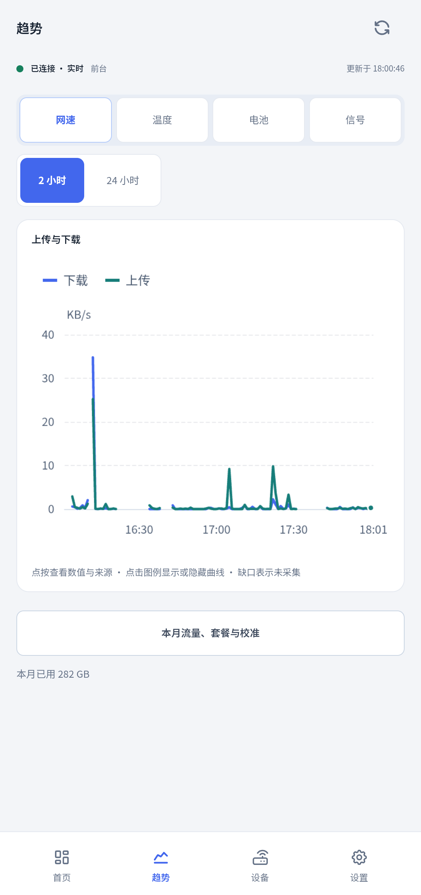</a><br /><strong>网速 · 2 小时</strong><br />上传与下载曲线、图例，以及流量管理入口。</td>
<td align="center" width="50%"><a href="docs/images/v1.3.58/trends-throughput-24h-tooltip.png">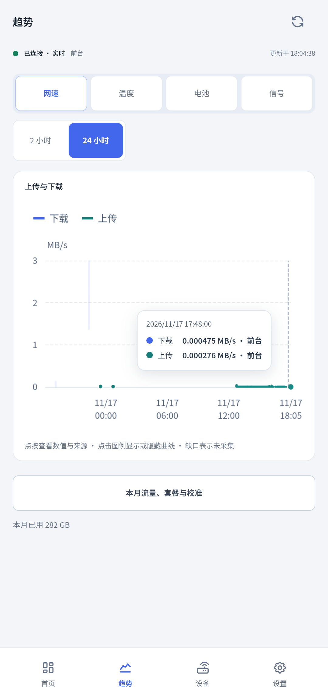</a><br /><strong>网速 · 24 小时与点按提示</strong><br />切换时间范围，点按曲线查看数值、时间与采集来源。</td>
</tr>
<tr>
<td align="center"><a href="docs/images/v1.3.58/trends-temperature-chart.png">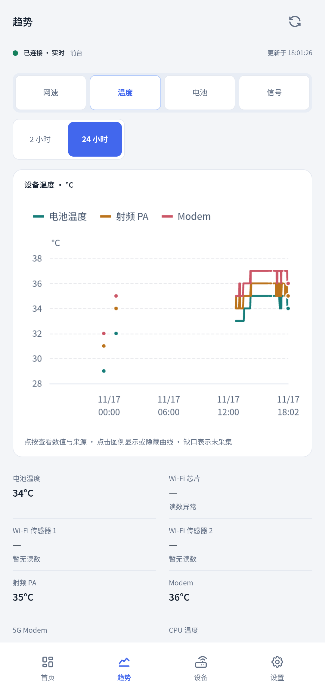</a><br /><strong>温度曲线</strong><br />各传感器的监测历史，点击图例可显示或隐藏曲线。</td>
<td align="center"><a href="docs/images/v1.3.58/trends-temperature-readings.png">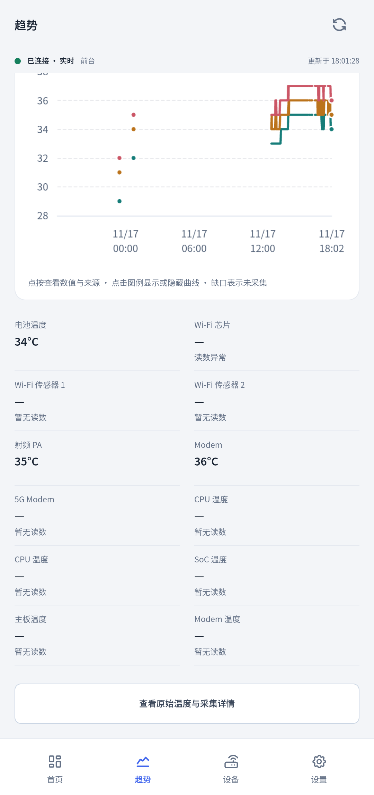</a><br /><strong>温度读数</strong><br />全部温度指标、异常或缺失说明，以及原始读数入口。</td>
</tr>
<tr>
<td align="center"><a href="docs/images/v1.3.58/trends-signal-rsrp.png">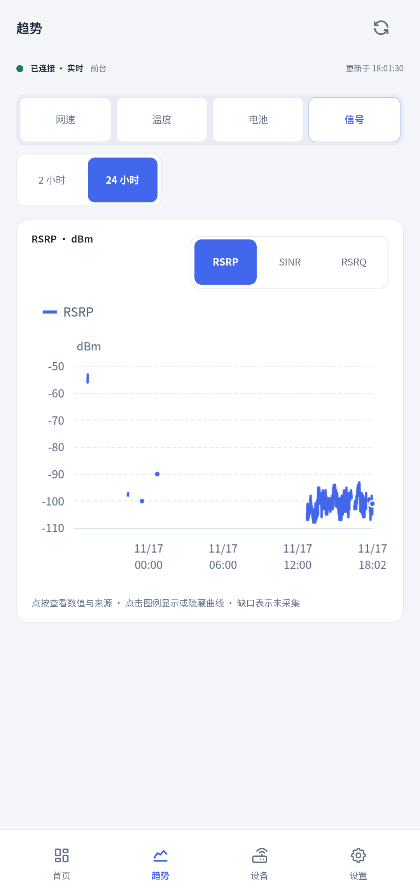</a><br /><strong>信号 · RSRP</strong><br />接收功率趋势，支持 2 小时与 24 小时切换。</td>
<td align="center"><a href="docs/images/v1.3.58/trends-signal-sinr.png">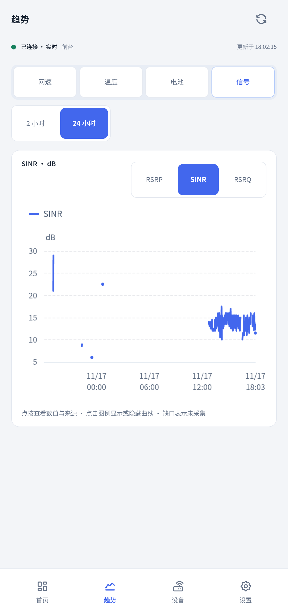</a><br /><strong>信号 · SINR</strong><br />信干噪比趋势。</td>
</tr>
<tr>
<td align="center"><a href="docs/images/v1.3.58/trends-signal-rsrq.png">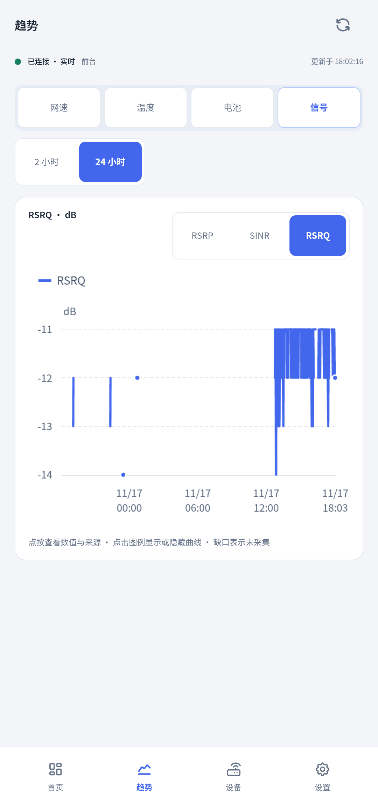</a><br /><strong>信号 · RSRQ</strong><br />接收质量趋势。</td>
<td></td>
</tr>
</table>

</details>

<details>
<summary><strong>原厂电池与续航记录（4 张）</strong></summary>

<table>
<tr>
<td align="center" width="50%"><a href="docs/images/v1.3.58/battery-chart-readings.png">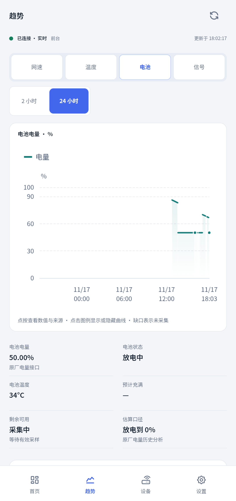</a><br /><strong>电量曲线与时间估算</strong><br />原厂电量、充放电状态、电池温度、预计充满与剩余可用。</td>
<td align="center" width="50%"><a href="docs/images/v1.3.58/battery-diagnostics-top.png">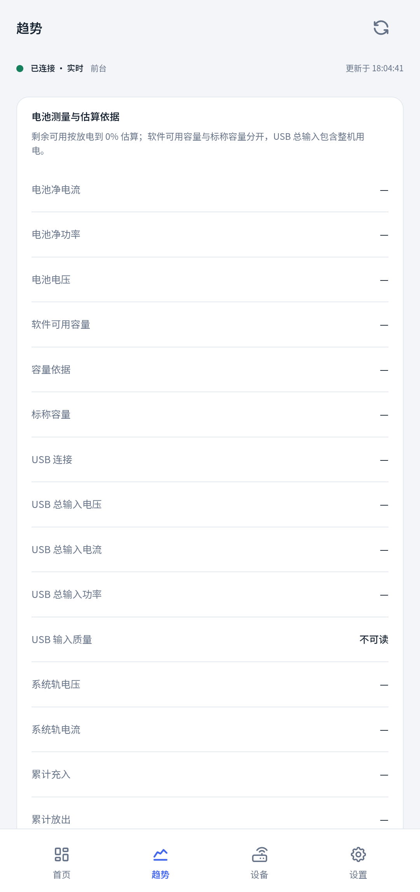</a><br /><strong>测量与估算依据 · 上部</strong><br />电流、电压、容量与 USB 输入等字段；原厂未提供的数值保留为缺失。</td>
</tr>
<tr>
<td align="center"><a href="docs/images/v1.3.58/battery-diagnostics-bottom.png">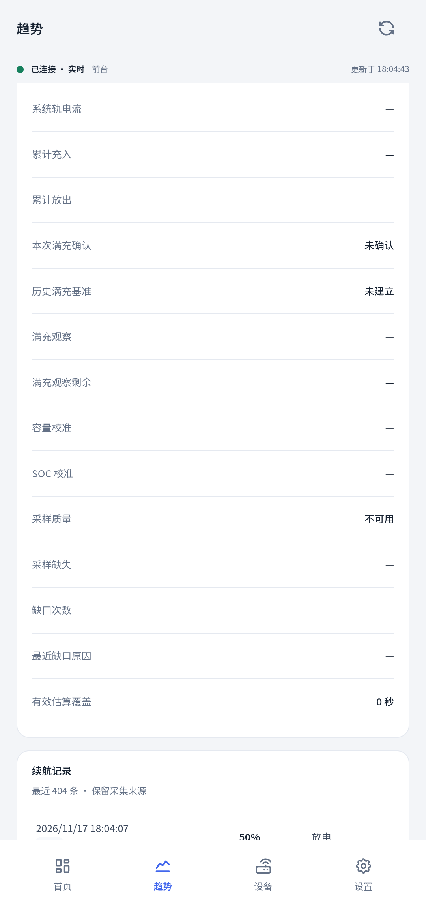</a><br /><strong>测量与估算依据 · 下部</strong><br />满充确认、校准、采样质量、缺口与有效估算覆盖；保留原厂接口的实际缺失状态。</td>
<td align="center"><a href="docs/images/v1.3.58/battery-history.png">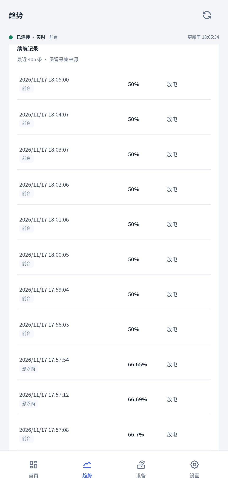</a><br /><strong>续航记录</strong><br />按时间查看电量与充放电历史，记录保留采集来源。</td>
</tr>
</table>

</details>

<details>
<summary><strong>流量、套餐与手动校准（3 张）</strong></summary>

<table>
<tr>
<td align="center" width="50%"><a href="docs/images/v1.3.58/usage-plan.png">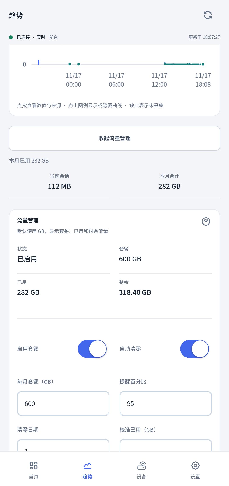</a><br /><strong>流量与套餐概况</strong><br />当前会话、本月合计，以及套餐状态、额度、已用和剩余流量。</td>
<td align="center" width="50%"><a href="docs/images/v1.3.58/usage-settings.png">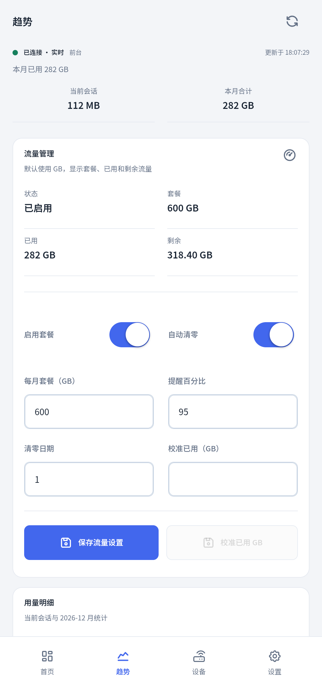</a><br /><strong>套餐设置与校准</strong><br />启用套餐、每月 GB、提醒比例、自动清零与日期，手动校准本月已用流量。</td>
</tr>
<tr>
<td align="center"><a href="docs/images/v1.3.58/usage-details.png">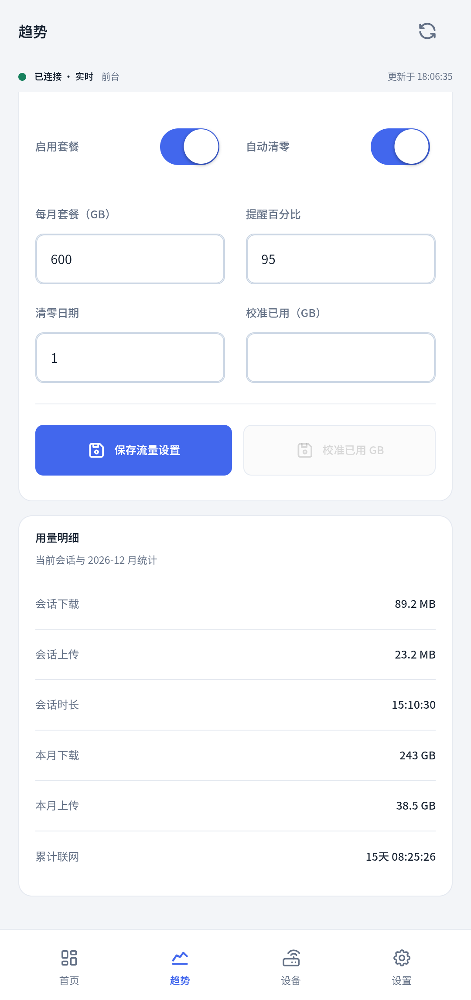</a><br /><strong>用量明细</strong><br />会话与本月的上传、下载和联网时间。</td>
<td></td>
</tr>
</table>

</details>

<details>
<summary><strong>连接设备、网络调优与频段锁定（7 张）</strong></summary>

<table>
<tr>
<td align="center" width="50%"><a href="docs/images/v1.3.58/devices-clients.png">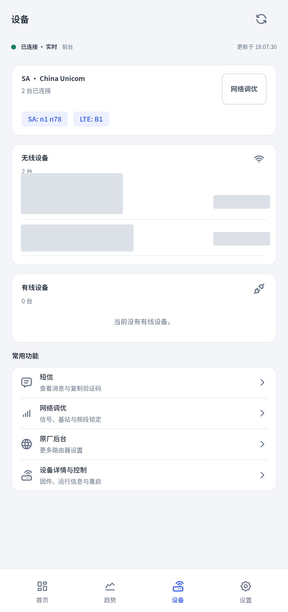</a><br /><strong>连接设备</strong><br />无线与有线设备、网络和锁定摘要，以及短信、调优、原厂后台、设备控制入口。</td>
<td align="center" width="50%"><a href="docs/images/v1.3.58/radio-network-serving.png">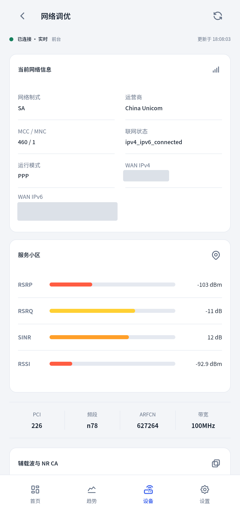</a><br /><strong>当前网络与服务小区</strong><br />网络信息、RSRP / RSRQ / SINR / RSSI，以及 PCI、频段、ARFCN 和带宽。</td>
</tr>
<tr>
<td align="center"><a href="docs/images/v1.3.58/radio-ca-trend.png">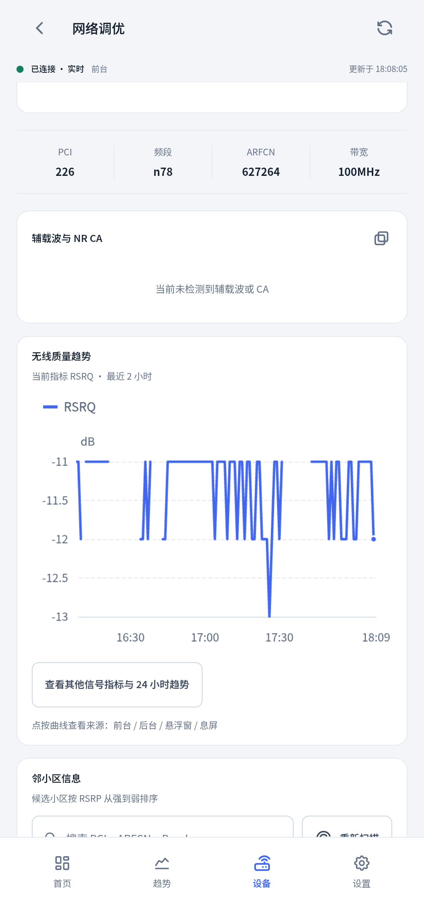</a><br /><strong>辅载波、CA 与无线质量趋势</strong><br />路由器实际返回的载波聚合信息，以及最近 2 小时信号曲线。</td>
<td align="center"><a href="docs/images/v1.3.58/radio-neighbors.png">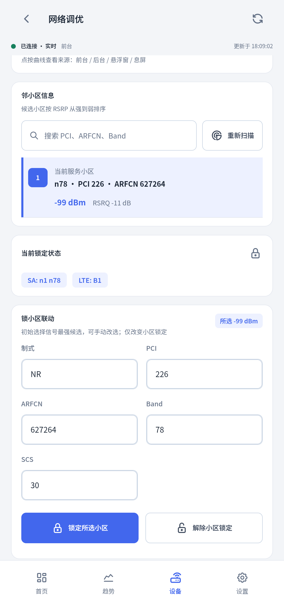</a><br /><strong>邻小区扫描与选择</strong><br />候选按信号强度排序，可搜索 PCI、ARFCN、Band，重新扫描并选择小区。</td>
</tr>
<tr>
<td align="center"><a href="docs/images/v1.3.58/radio-cell-lock.png">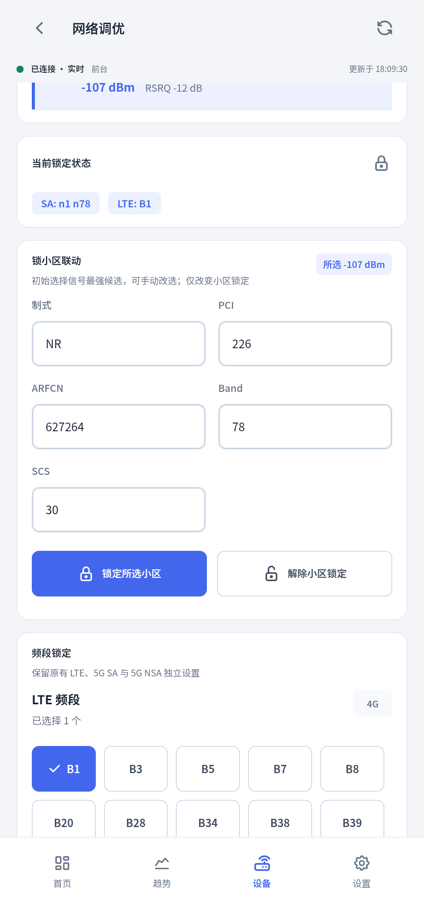</a><br /><strong>小区锁定</strong><br />当前锁定状态、所选候选参数，以及锁定和解除小区锁定入口。</td>
<td align="center"><a href="docs/images/v1.3.58/radio-bands-lte.png">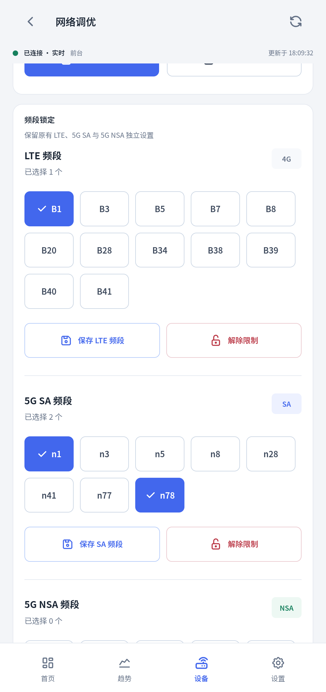</a><br /><strong>LTE 频段</strong><br />独立选择 LTE 频段、保存或解除限制。</td>
</tr>
<tr>
<td align="center"><a href="docs/images/v1.3.58/radio-bands-sa-nsa.png">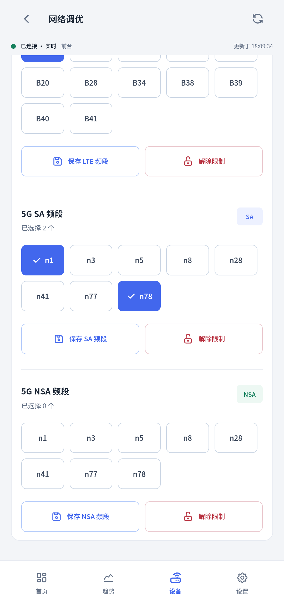</a><br /><strong>5G SA 与 NSA 频段</strong><br />两组独立频段选项及保存、解除限制按钮。</td>
<td></td>
</tr>
</table>

</details>

<details>
<summary><strong>短信、原厂后台与设备控制（6 张）</strong></summary>

<table>
<tr>
<td align="center" width="50%"><a href="docs/images/v1.3.58/sms-inbox.png">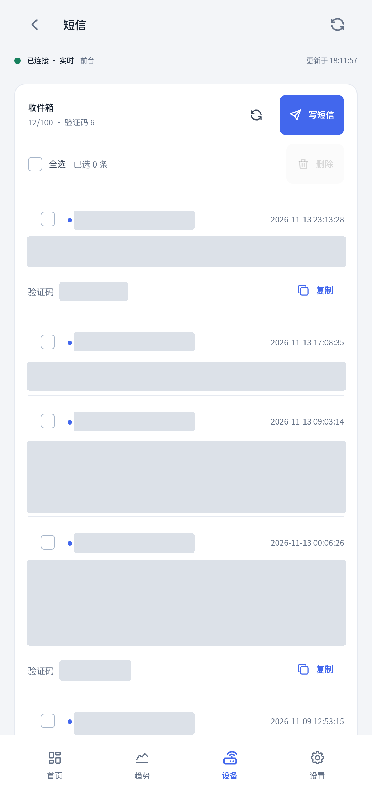</a><br /><strong>短信收件箱</strong><br />容量、消息列表、刷新与验证码复制；敏感短信信息已遮挡。</td>
<td align="center" width="50%"><a href="docs/images/v1.3.58/sms-selection.png">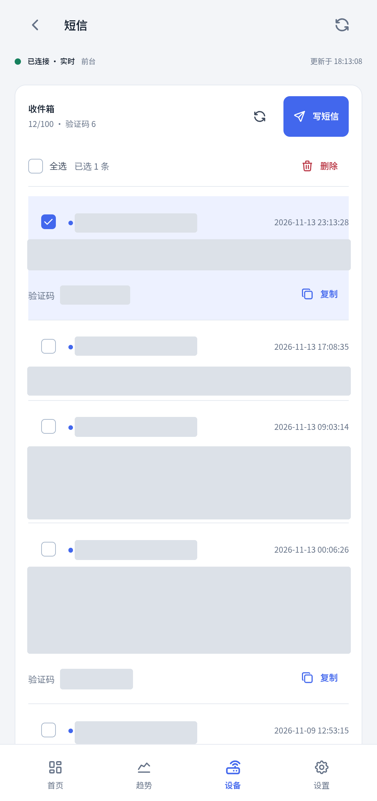</a><br /><strong>短信选择与批量删除</strong><br />勾选消息、全选、已选数量，以及批量删除入口。</td>
</tr>
<tr>
<td align="center"><a href="docs/images/v1.3.58/sms-compose.png">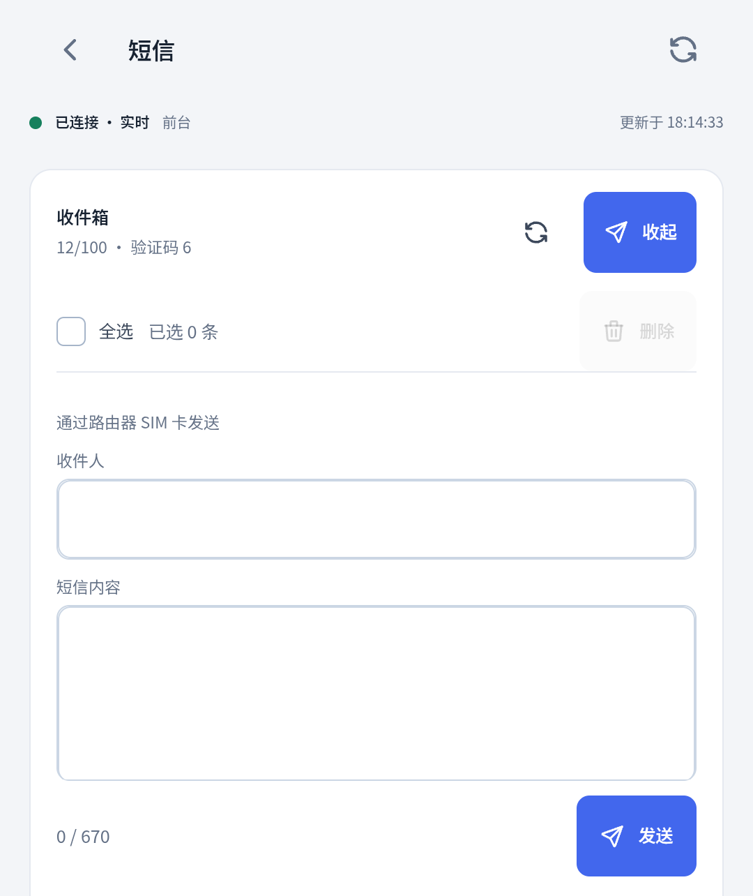</a><br /><strong>写短信</strong><br />通过路由器 SIM 卡发送，提供收件人、内容和字数计数。</td>
<td align="center"><a href="docs/images/v1.3.58/stock-console.png">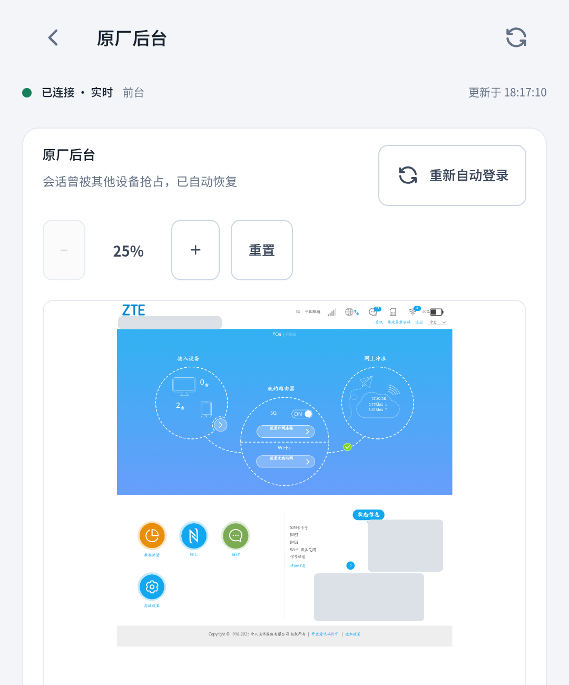</a><br /><strong>原厂后台</strong><br />缩小后完整查看原厂页面；自动登录状态、缩放与重置入口。</td>
</tr>
<tr>
<td align="center"><a href="docs/images/v1.3.58/device-details.png">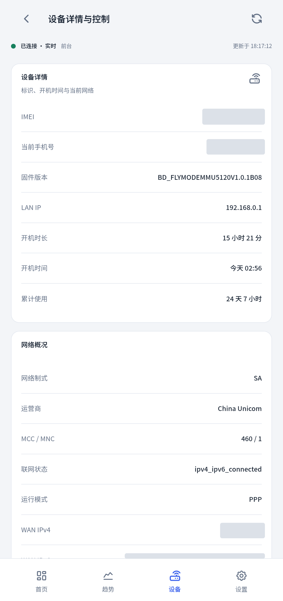</a><br /><strong>设备详情</strong><br />固件、设备标识、开机与累计使用信息、网络概况；敏感标识已遮挡。</td>
<td align="center"><a href="docs/images/v1.3.58/device-controls.png">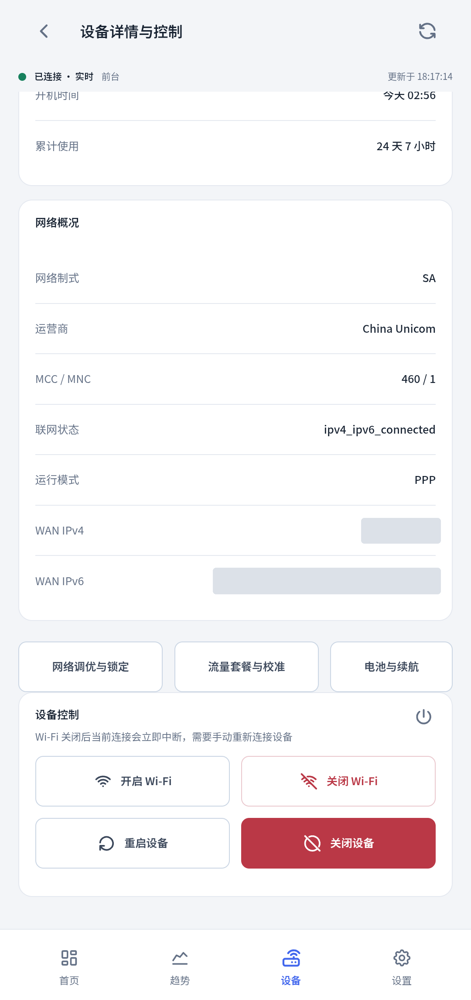</a><br /><strong>设备控制</strong><br />Wi-Fi 开关、重启和关机，以及网络、流量、电池详情跳转入口。</td>
</tr>
</table>

</details>

<details>
<summary><strong>连接设置、原厂电量、后台采集与悬浮监测（5 张）</strong></summary>

<table>
<tr>
<td align="center" width="50%"><a href="docs/images/v1.3.58/settings.png"></a><br /><strong>设置入口</strong><br />路由器连接、电量来源、后台权限、悬浮开关、软件更新与诊断。</td>
<td align="center" width="50%"><a href="docs/images/v1.3.58/settings-connection.png">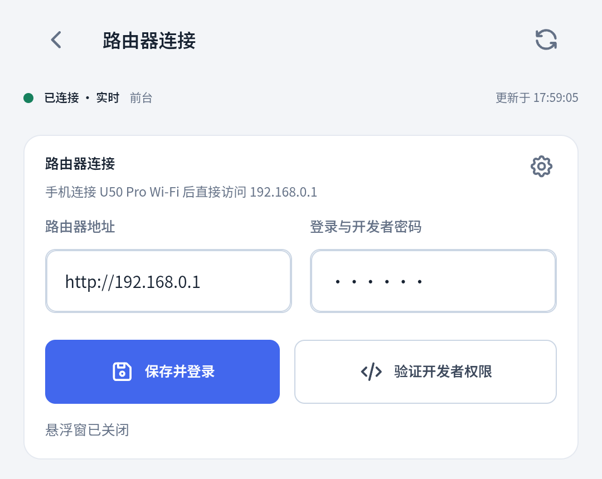</a><br /><strong>路由器连接</strong><br />管理地址、密码、保存并登录，以及开发者权限验证。</td>
</tr>
<tr>
<td align="center"><a href="docs/images/v1.3.58/settings-battery-factory.png"></a><br /><strong>原厂电量来源</strong><br />常规版使用路由器原厂返回的电池百分比。</td>
<td align="center"><a href="docs/images/v1.3.58/settings-background.png">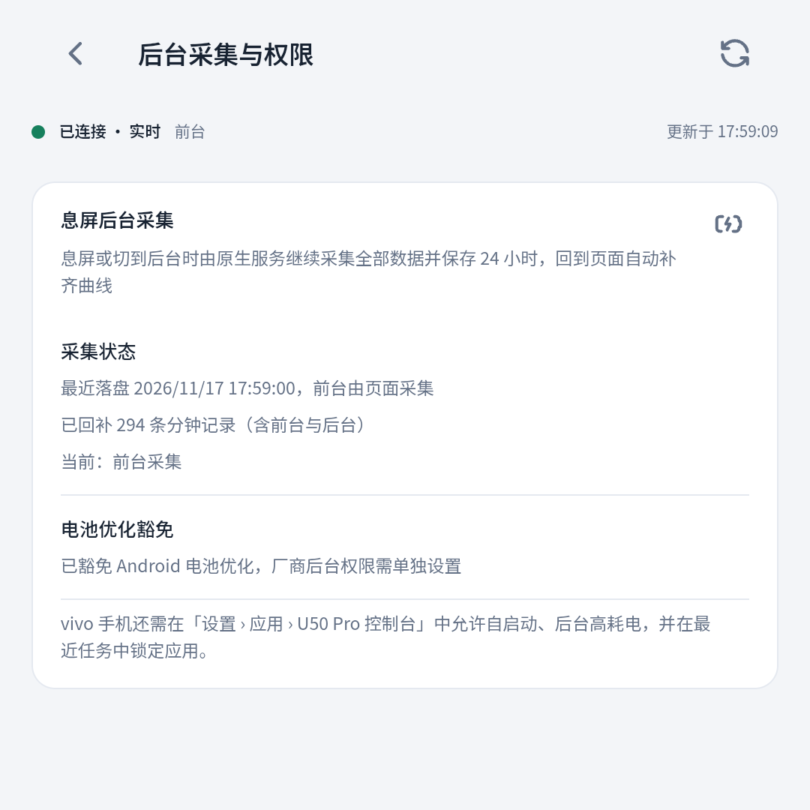</a><br /><strong>后台采集与权限</strong><br />采集状态、历史回补、采集来源、电池优化豁免与手机后台权限说明。</td>
</tr>
<tr>
<td align="center"><a href="docs/images/v1.3.58/overlay-live.png">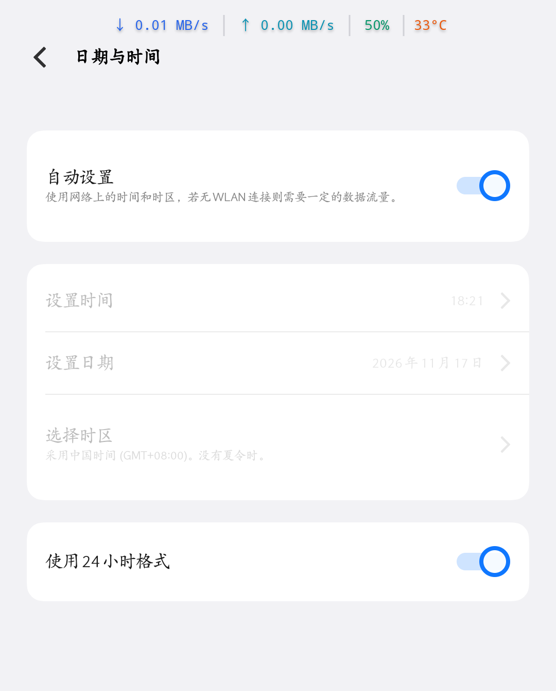</a><br /><strong>实时悬浮监测</strong><br />在其他应用上方显示上传、下载、电量与电池温度，可拖动位置。</td>
<td></td>
</tr>
</table>

</details>

<details>
<summary><strong>软件更新与采集诊断（3 张）</strong></summary>

<table>
<tr>
<td align="center" width="50%"><a href="docs/images/v1.3.58/settings-update.png">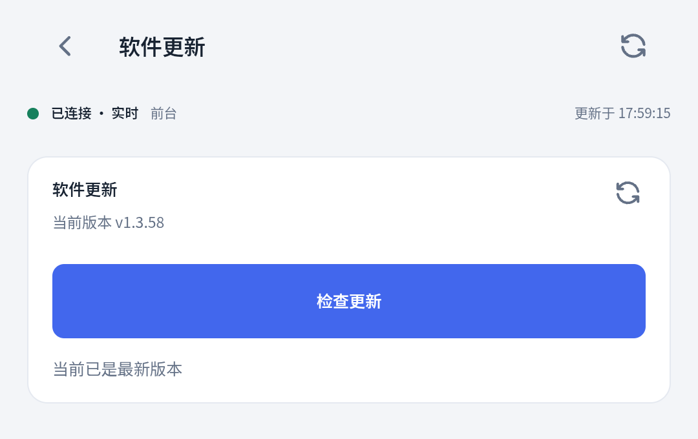</a><br /><strong>软件更新</strong><br />当前版本、手动检查更新与实际检查结果。</td>
<td align="center" width="50%"><a href="docs/images/v1.3.58/diagnostics-sources-temperature.png">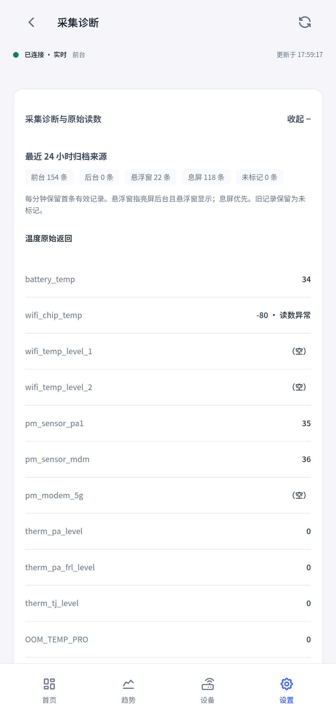</a><br /><strong>来源统计与原始温度</strong><br />最近 24 小时的归档来源计数、温度原始字段与异常读数说明。</td>
</tr>
<tr>
<td align="center"><a href="docs/images/v1.3.58/diagnostics-runtime.png">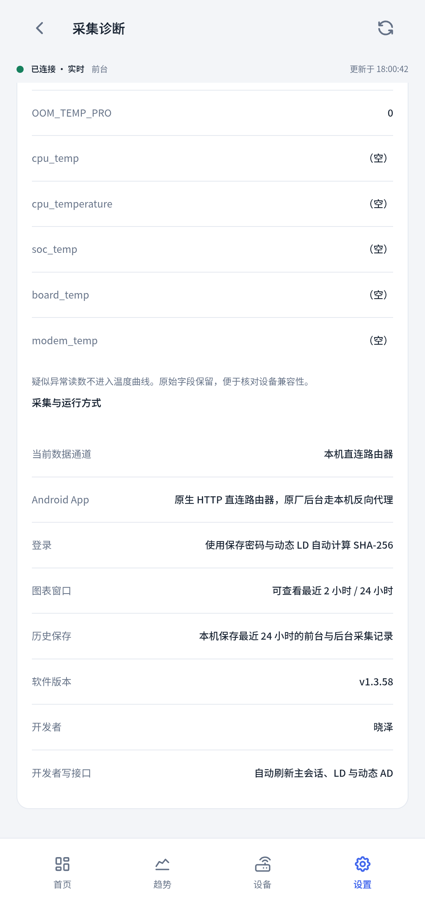</a><br /><strong>采集与运行方式</strong><br />本机通信、登录方式、图表窗口、历史保存、软件版本与开发者信息。</td>
<td></td>
</tr>
</table>

</details>

## 四个页面入口

| 页面 | 主要功能 |
| --- | --- |
| 首页 | 下载与上传速率、电池电量及时间估算、蜂窝信号、温度，以及流量、设备和短信入口 |
| 趋势 | 网速、温度、电量和信号曲线；最近 2 小时或 24 小时切换；电池历史记录 |
| 设备 | 连接设备、网络调优、短信、原厂后台、设备详情与控制 |
| 设置 | 路由器连接、电量来源、后台采集与权限、悬浮监测、软件更新、采集诊断 |

首页点击信号区域可直接进入网络调优。图表支持点按查看数值和采集来源，温度图例可显示或隐藏曲线；读取失败、数据缺口与实际零值分别显示。

## 原厂电池与续航

常规版读取路由器原厂返回的电量、充电状态和电池温度。电量使用 `battery_vol_percent` / `battery_value`，充电状态依据原厂充电及外部供电标记。

“预计充满”和“剩余可用”独立显示，采用同一套前后台估算规则：

- 保留最近 24 小时电量历史，取当前连续充电或放电状态的记录。
- 至少有两个有效记录、时间跨度达到 0.15 小时（9 分钟），且电量按对应方向发生变化后，才生成时间估算。
- 用该段首尾电量差除以时间跨度，得到每小时电量变化；充电估算到 100%，放电估算到 0%。
- 数据不足时显示采集状态；不适用的时间项显示对应原因。

估算反映近期使用条件下的电量变化，不代表电池容量实测或健康度。路由器未返回的电压、电流、容量和健康度保留为缺失值。

## 本机监测、历史与悬浮窗

应用启动后，Android 原生服务在切到后台或息屏时继续访问路由器，通过常驻通知显示运行状态。前台与后台共享连接配置及登录会话，回到应用后自动补齐本机历史。

- 默认每秒采集，温度、信号、网速与电池按分钟归档，保留最近 24 小时。
- 历史记录区分前台、后台、悬浮窗和息屏来源；图表提示与采集诊断可查看来源信息。
- 曲线保留实际采样值，数据缺口处断开；刷新时保留图例选择及时间窗口。
- 悬浮窗显示下载、上传、电量和电池温度，可拖动并保存位置；路由器不可达时显示离线状态。
- 已启用的监测服务支持在开机和覆盖更新后恢复，实际后台运行仍受手机系统权限及电池管理影响。

配置与历史保存在当前手机，不进行跨设备同步。

## 路由器管理

| 功能 | 内容 |
| --- | --- |
| 网络与信号 | 网络制式、运营商、RSRP、RSRQ、SINR、RSSI、频段、PCI、ARFCN、带宽及 CA；NSA 分列 5G 与 LTE 锚点 |
| 网络调优 | LTE / 5G NR 邻小区扫描、候选排序与搜索、小区锁定和解除、LTE / 5G SA / NSA 频段选择 |
| 流量 | 会话与本月用量、上传和下载统计、套餐与提醒设置、手动校准本月已用流量 |
| 短信 | 列表与容量、内容解码、验证码复制、发送及结果查询 |
| 连接设备 | 无线和有线设备数量、名称、IP、MAC，以及路由器实际返回的设备信息 |
| 设备控制 | Wi-Fi 开关、重启、关机及开发者权限验证 |

原厂后台可从「设备 → 原厂后台」打开。应用使用已保存密码尝试自动登录管理员和开发者会话，通过 Android 本机代理加载路由器原厂界面；本机代理未启动时回退到原生全屏方式，按系统返回键回到应用。

本应用通过局域网访问路由器，未接入中兴智慧生活云端。各项指标及控制能力以设备固件实际支持为准；关闭 Wi-Fi 会断开相应连接，关机后无法通过应用远程开机。

## APK 软件更新

在「设置 → 软件更新」检查 GitHub 最新正式 Release。启动时静默检查，成功结果缓存一小时；手动检查会跳过缓存。草稿和预发布版本不作为更新推送。

发现更高版本后，可在应用内下载 APK、查看进度并调起系统安装。安装前校验包名、版本名、递增的版本代码与签名；首次使用可能需要允许此应用安装 APK。

## 从源码构建

项目仅发布 Android App。EXE、独立 H5 预览、浏览器开发代理和跨设备互通入口已移除。Vue、uni-app 和 ECharts 用于 APK 内嵌页面，Android 原生层负责路由器通信、后台采集、悬浮窗和更新安装。

准备 Node.js / npm、兼容当前工程的 Java 与 Gradle，以及 Android SDK。当前 Android 工程使用 SDK Platform 30 和 Build Tools 30.0.3；本机 SDK 路径配置在 `android-wrapper/local.properties`，发布签名文件应在本机配置。

在项目根目录运行：

```powershell
npm ci
npm run build:app
```

Gradle 会生成并打包 App 内嵌页面，输出：

```text
android-wrapper/app/build/outputs/apk/release/app-release.apk
```

发布时同步根目录 `package.json`、`package-lock.json`、`src/manifest.json` 和 `android-wrapper/app/build.gradle` 的版本信息，递增 Android 版本代码，并同步当前文档及原生测试配置。保持既有发布签名，创建正式 Release，使用 `v主版本.次版本.修订号` 标签并设为 Latest。更新器要求 APK 文件名与标签严格对应，例如 `v1.3.58` 对应 `U50PRO-Console-v1.3.58.apk`。

更多接口字段与命令见 [路由器接口目录](docs/router-api-inventory.md)，测试范围与修复记录见 [1.3.58 验收记录](docs/verification-1.3.58.md)。
