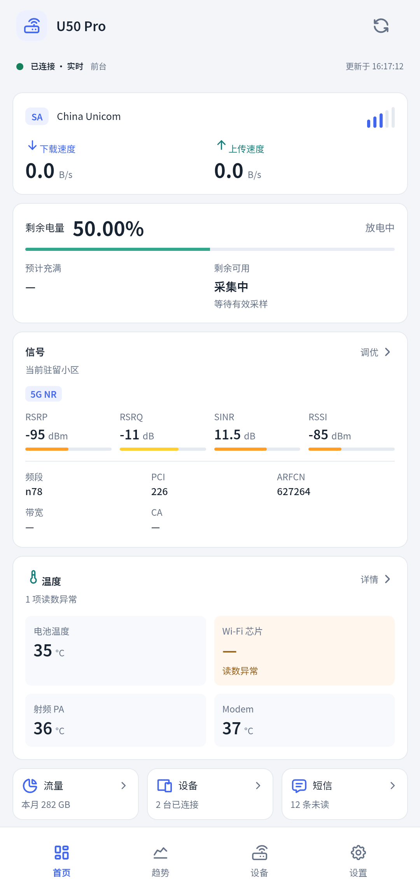
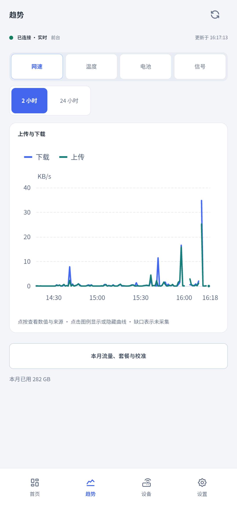
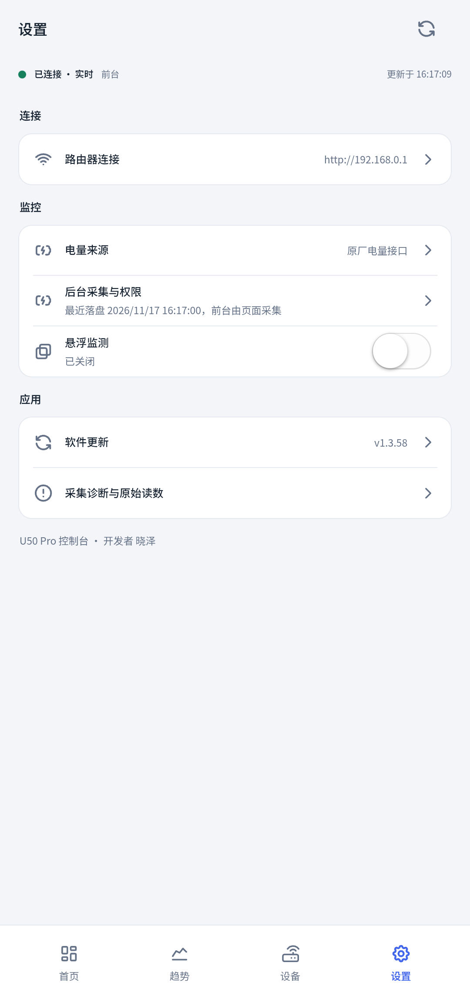

# U50 Pro 控制台 1.3.58

发布日期：2026 年 11 月 17 日。Android 常规版，版本代码 `78`，包名 `cn.mu5120.console`。

## 本次更新

- 整理为 Android App 项目，移除 EXE、独立 H5 预览、浏览器开发代理和跨设备互通入口，统一通过 `npm run build:app` 构建 APK。
- 保留首页实时网速、电量、信号和温度入口，以及网络调优、短信、连接设备、流量套餐和设备控制。
- 常规版电池使用原厂电量、充电状态与温度；续航按最近 24 小时内连续同状态记录的首尾电量变化估算，至少积累 9 分钟有效跨度。
- 保留本机后台采集、24 小时历史、采集来源标记和可拖动悬浮监测，返回应用后自动补齐曲线。
- 原厂后台继续通过 Android 本机代理加载，使用保存的密码尝试自动登录；APK 更新继续从 GitHub 正式 Release 下载并校验安装包。
- 修复邻区扫描失败仍提示已发送，以及解除小区锁定失败或部分成功时误报全部成功的问题。
- 修复关闭悬浮窗后返回应用，被后台进程旧设置重新开启的问题。

## 界面

**首页**

**趋势**

**设置**

截图来自常规版实机，裁去系统状态栏，未替换界面数据。

## 安装

下载本次 Release 附件 `U50PRO-Console-v1.3.58.apk`，在连接路由器局域网的 Android 手机上安装。应用内也可从「设置 → 软件更新」检查更高版本并下载。

覆盖安装要求包名、签名一致且版本代码递增，可保留本机配置及历史；卸载或清除应用数据会删除这些内容。后台采集随应用启动，需要息屏持续采集时按设置页说明授权；悬浮窗通过设置页开关启用。

[验收范围与结果](../verification-1.3.58.md) · [返回项目说明](../../README.md)
